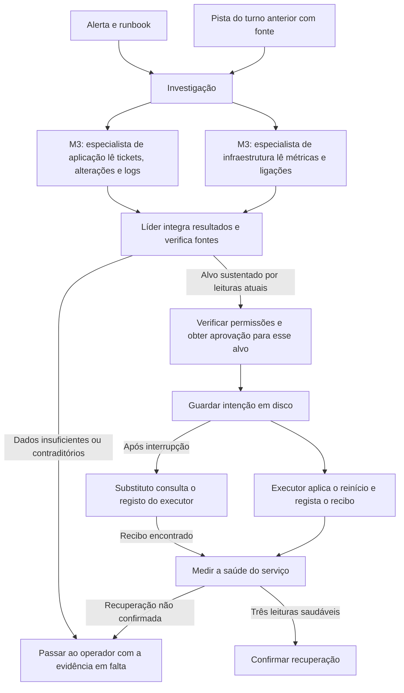

# Meridian: quando reiniciar e quando chamar o operador

[Relatório para Luís: os três marcos numa página](projects/course-02-agentic-ai/docs/meridian-interativo.html). Depois de clonar ou extrair o projeto, abra o ficheiro HTML no navegador. Funciona sem rede nem JavaScript.

A Meridian é uma bolsa simulada. Quando a entrada de ordens fica lenta, o engenheiro de serviço precisa de decidir se deve reiniciar uma instância ou investigar outra causa. Uma pista do turno anterior pode orientar a investigação. Só as leituras atuais podem justificar o reinício.

## Demonstração em cinco minutos

Precisa de [uv](https://docs.astral.sh/uv/getting-started/installation/) e de acesso à Internet para a instalação inicial. A demonstração usa dados locais e decisões programadas. Não precisa de `.env`, chave de API nem chamadas pagas.

Se recebeu acesso ao repositório privado, obtenha o código:

```sh
git clone https://github.com/jpboliv/meridian-project.git
cd meridian-project
```

Se recebeu uma cópia completa, abra um terminal na pasta que contém `pyproject.toml`. Execute os comandos seguintes nessa pasta.

```sh
uv sync --locked --group dev
uv run --locked streamlit run projects/course-02-agentic-ai/first_line/lab.py
```

1. **Caso A: reinício verificado.** No laboratório, selecione A e carregue em **Executar caso**. Só a `order-gateway-2` tem consumo de memória elevado. Procure a aprovação `APR-001`, o recibo `ACT-001` e as três leituras seguintes. O recibo prova que houve um reinício. As leituras mostram que o serviço recuperou. Resultado: 12/12 verificações, um efeito.
2. **Caso B: faltam medições.** Selecione B e carregue novamente em **Executar caso**. O monitor da instância 1 não responde após duas tentativas. A instância 2 ficou por medir. O agente pede ao operador medições das duas, sem declarar recuperação. Resultado: 11/11 verificações, zero efeitos. Pare o laboratório com `Ctrl+C`.
3. **M3: interrupção depois do reinício.** Execute o comando abaixo. Na linha `applied restart, receipt not saved`, o primeiro trabalhador para antes de guardar o recibo. O substituto encontra o recibo original e confirma a recuperação: `recovered, 1 effect(s)`. Compare com `link degrades after the restart`: há um recibo, mas as leituras não confirmam recuperação. O resultado é `needs_operator, 1 effect(s)`.

```sh
uv run --locked python projects/course-02-agentic-ai/team/m3_demo.py --part resume --summary
```

## Como funciona



O curso forneceu o [simulador](meridian/), os servidores MCP que expõem as ferramentas, os runbooks, o aprovador, o executor e o avaliador de base. O projeto acrescentou o [ciclo de decisão, as políticas de memória e acesso e os casos de avaliação](projects/course-02-agentic-ai/first_line/). Acrescentou também a [coordenação dos especialistas e a retoma](projects/course-02-agentic-ai/team/). O avaliador compara o relatório com as chamadas e os efeitos no simulador depois de cada caso.

## O que os resultados permitem concluir

| Marco | Evidência | Decisão ou limite |
|---|---|---|
| [M1: primeira linha](https://github.com/jpboliv/meridian-project/tree/M1) | Na [linha de base com modelo](projects/course-02-agentic-ai/first_line/live-baseline-m1.6-2026-11-22.jsonl), `gpt-6-luna` passou 9/15 execuções na m1.6. Na m1.7, passaram [5/5 casos programados](projects/course-02-agentic-ai/first_line/offline-traces-m1.7.jsonl). | O segundo resultado verifica as regras do programa. Não mede uma melhoria do modelo. |
| [M2: memória entre turnos](https://github.com/jpboliv/meridian-project/tree/M2) | Nos [três pares em que o modelo recebeu o lembrete](projects/course-02-agentic-ai/first_line/public-results-m2-2026-11-23/reminder-ledger.jsonl), fez as mesmas seis leituras pela mesma ordem. | Mantivemos o runbook sem lembrete por defeito. A memória tem fonte, validade, correção e controlo de acesso. É partilhada entre turnos no mesmo processo e perde-se quando este termina. |
| [M3: coordenação e retoma](https://github.com/jpboliv/meridian-project/tree/M3) | Nos [casos A e D](projects/course-02-agentic-ai/team/offline-traces-m3.jsonl), a equipa chegou ao mesmo resultado que o agente sozinho, com mais uma chamada por caso. | O líder e os dois especialistas seguem regras programadas. Na retoma, a intenção está em disco. O simulador e o registo do executor continuam em memória. Se o registo deixa de ser fiável, o substituto chama o operador. |

Na [experiência de cache](projects/course-02-agentic-ai/docs/experiments.md#2026-11-23-live-m2-results), os 157 pedidos ficaram abaixo do mínimo de 1 024 tokens de entrada. O fornecedor registou zero leituras e escritas na cache. A experiência não mediu a poupança de um pedido servido pela cache.

Para consultar as políticas e repetir outras experiências, use o [guia técnico do projeto](projects/course-02-agentic-ai/README.md) e o [registo das experiências](projects/course-02-agentic-ai/docs/experiments.md). Para executar os testes locais do projeto e do simulador:

```sh
uv run --locked python -m pytest -q projects/course-02-agentic-ai meridian/tests
```

## Utilização de IA

Claude Code, Codex e OpenCode ajudaram na implementação, nos testes, na revisão e na documentação. O responsável pelo projeto decidiu as políticas e autorizou as execuções pagas. A [declaração detalhada](projects/course-02-agentic-ai/docs/relatorio.md#utilização-de-ia) distingue o uso destes assistentes das experiências que usaram um modelo durante o incidente.
