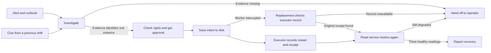

# Meridian: incident response with agents

An order gateway is slow. Yesterday, restarting one instance helped. Should the on-call agent restart it again? Meridian investigates that question in a simulated stock exchange. A past incident can suggest where to look. Only current readings can justify a restart, and only readings *after* the restart can establish recovery.

I built this project during Luís Noronha’s *Agentic AI: Da Arquitetura à Implementação* course. The [original course repository](https://github.com/luisnoronha/gen-ai-course) supplies the exchange simulator, tools and Model Context Protocol (MCP) servers, runbooks, approver, executor, and base evaluator. My work is in [`projects/course-02-agentic-ai`](projects/course-02-agentic-ai/): the agent’s decision loop, memory and permission rules, specialist handoffs, worker recovery, and the cases and graders that test them.

[Run the demo](#run-the-demo) · [Read the results](#what-the-evaluations-showed) · [Browse the experiment log](projects/course-02-agentic-ai/docs/experiments.md). For the illustrated case study, open the [one-page HTML report](projects/course-02-agentic-ai/docs/meridian-interactive.html) in a browser from a local copy. It works offline without JavaScript.

## Where the decisions happen

| Role | What it decides |
|---|---|
| First-line agent | In live runs, a model chooses what to read and proposes a restart or a handoff. The offline demo uses a fixed decision sequence. |
| Incident lead and two specialists | In the scripted team, the application specialist reads tickets, changes, and logs. The infrastructure specialist reads instance and link metrics. The lead checks their sources and can ask one follow-up if findings conflict. |
| Application code | Checks fresh evidence and permissions, requests approval for the exact target, records the intent, and calls the executor. After an interruption, the next worker checks the executor’s record before deciding whether to act. |
| Evaluator | Compares the agent’s report with tool calls, actual effects, and the state of the exchange. A plausible explanation is not enough to pass. |



## Run the demo

Allow about five minutes after setup. Install [uv](https://docs.astral.sh/uv/getting-started/installation/) first. The initial setup downloads dependencies. The demo uses local data and needs no `.env`, API key, or paid model calls.

```sh
git clone https://github.com/jpboliv/meridian-project.git
cd meridian-project
uv sync --locked --group dev
uv run --locked streamlit run projects/course-02-agentic-ai/first_line/lab.py
```

If you downloaded an archive, start in the directory containing `pyproject.toml` and run the last two commands. In the lab, the Portuguese button **Executar caso** means **Run case**.

1. **A: verify a restart.** Select A and run the case. Only `order-gateway-2` has high memory use. Find approval `APR-001`, receipt `ACT-001`, and the next three health readings. The receipt shows that the restart happened. The readings show that it worked. Expect 12/12 checks and one effect.
2. **B: hand off missing evidence.** Select B and run it. The monitor times out twice on instance 1. Nobody measured instance 2. The agent asks the operator for readings from both. Expect 11/11 checks and zero effects. Stop the lab with `Ctrl+C`.
3. **M3: interrupt the worker.** From the same directory, run:

   ```sh
   uv run --locked python projects/course-02-agentic-ai/team/m3_demo.py --part resume --summary
   ```

   Compare `applied restart, receipt not saved` with `link degrades after the restart`. Both record one restart. The first ends in `recovered`; the second ends in `needs_operator`. A receipt is not a reason to restart again or declare the service healthy.

## What the evaluations showed

| Question | Result | Engineering decision |
|---|---|---|
| [M1](https://github.com/jpboliv/meridian-project/tree/M1): Can the agent finish an incident? | The [live m1.6 baseline](projects/course-02-agentic-ai/first_line/live-baseline-m1.6-2026-11-22.jsonl) passed 9/15 runs. In one failure, the model repeatedly read a degraded link but never cited it in its handoff. | When refreshing stale samples yields no new evidence, code now ends the loop and writes the handoff. [Five scripted m1.7 cases](projects/course-02-agentic-ai/first_line/offline-traces-m1.7.jsonl) passed. That tests the rule, not an improvement in model performance. |
| [M2](https://github.com/jpboliv/meridian-project/tree/M2): Does a reminder save work? | All [12 live runs](projects/course-02-agentic-ai/first_line/public-results-m2-2026-11-23/reminder-ledger.jsonl) passed. In the three pairs where the model saw the reminder, it made the same six reads in the same order. | Keep the runbook alone by default. When a shift does save a clue, record its source, check who can read it, and withdraw it if later evidence contradicts it. |
| M2: Does prompt caching reduce cost here? | All [45 live runs](projects/course-02-agentic-ai/docs/experiments.md#2026-11-23-live-m2-results) passed. All 157 requests fell below the provider’s 1,024-token minimum. It reported no cache reads or writes. | Do not attribute cost differences to caching. This workload could not measure the benefit of a cache hit. |
| [M3](https://github.com/jpboliv/meridian-project/tree/M3): What does a team add? | In [cases A and D](projects/course-02-agentic-ai/team/offline-traces-m3.jsonl), the scripted team reached the single agent’s decision with one extra tool call per case. In M, conflicting findings prompted a fresh link check before any restart. | Give specialists read-only access. Keep approval and dispatch with the lead. |

The recovery demo covers worker replacement within a running simulator. The checkpoint lives on disk. Shift memory, executor receipts, and the executor’s ledger live in process memory. If the ledger disappears, the replacement hands the incident to an operator. A [later two-interruption experiment](projects/course-02-agentic-ai/post_release/README.md) found a separate bug: after 14 of 32 calls, the third worker inherited 19 calls instead of 18.

For the full evaluation suite, run:

```sh
uv run --locked python -m pytest -q projects/course-02-agentic-ai meridian/tests
```

The [technical guide](projects/course-02-agentic-ai/README.md) links to the case inputs, policy specifications, and reproduction commands.

## Use of AI

I used Claude Code, Codex, and OpenCode for implementation, tests, review, and documentation. I made the policy decisions and authorized the paid runs. The model used *inside* the agent for the reported M1 baseline and M2 live studies was `gpt-6-luna`.
