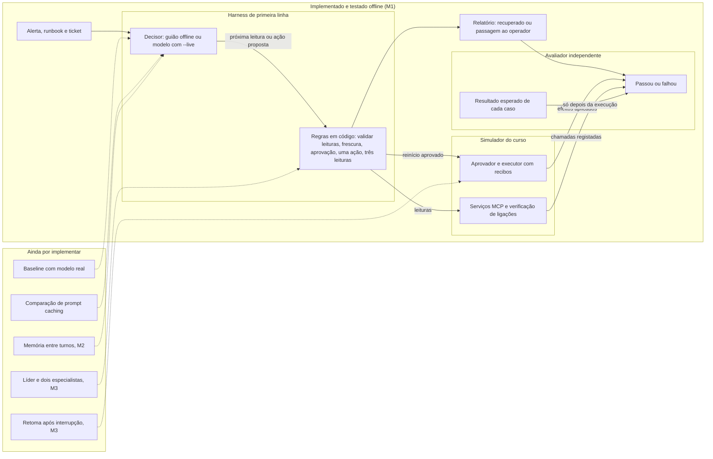
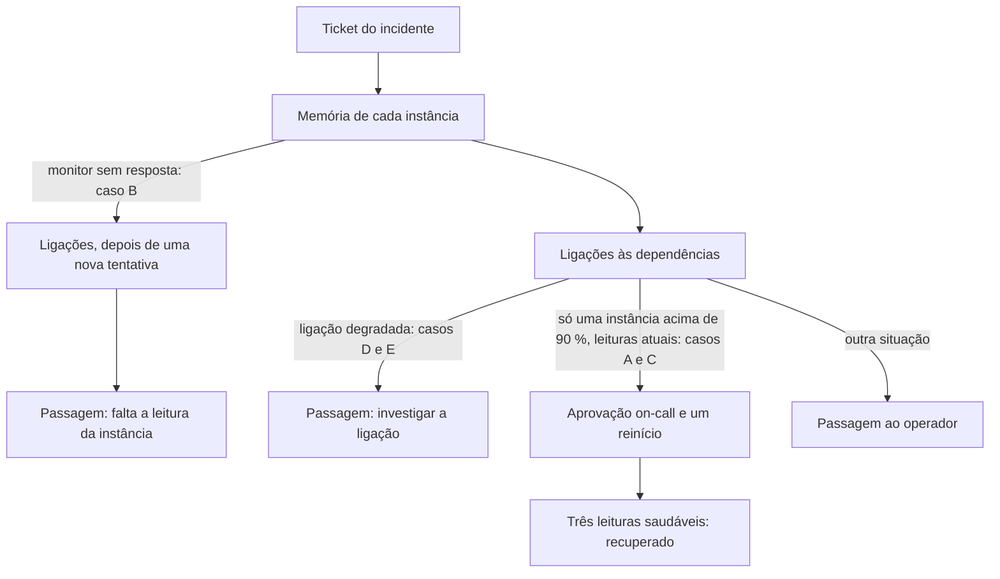

# Meridian: o agente de primeira linha

Projeto Agentic AI · 21 de novembro de 2026 · M1 em revisão ([PR #1](https://github.com/jpboliv/meridian-project/pull/1))

## O que o agente faz

Recebe o alerta «o gateway de ordens está lento». Lê o runbook, encontra o ticket do incidente, lê a memória de cada instância e verifica as duas ligações de que o gateway depende. Só reinicia uma instância se for a única acima de 90 % de memória, com leituras atuais e ligações saudáveis. Nesse caso, o código pede aprovação ao on-call, executa uma vez e só declara recuperação depois de três leituras saudáveis posteriores ao reinício. Nos outros casos, passa ao operador a lacuna ou a pista concreta, sem alterar nada.

O decisor escolhe apenas a próxima leitura ou propõe uma ação. Nos resultados abaixo é um guião fixo, sem modelo. O código valida cada leitura, a aprovação e o recibo. No fim, um avaliador independente compara o relatório com o resultado esperado e com os efeitos que o simulador registou. O agente nunca vê esse resultado esperado.





## Dois resultados

**Suportado, caso A.** A instância 2 estava a 93,9 % de memória e as duas ligações estavam ativas. A aprovação APR-001 autorizou o reinício ACT-001 no tick 23. As três leituras seguintes deram 6,5, 5,0 e 5,0 ms, com 0,1 % de erros. O avaliador contou um efeito e confirmou a recuperação durante cinco ticks. [Registo do caso A](../first_line/offline-traces-m1.4.jsonl#L1).

**Falha controlada, caso B.** O monitor de instâncias não respondeu duas vezes na instância 1. As ligações foram verificadas depois da nova tentativa e estavam ativas, mas isso não diz qual instância tem memória alta. O agente não reiniciou nada e pediu leituras atuais da instância 1. O avaliador contou zero efeitos. [Registo do caso B](../first_line/offline-traces-m1.4.jsonl#L2). Um [teste do avaliador](../first_line/test_case_checks.py) confirma que o atalho de saltar o monitor reprova.

Os cinco casos públicos passam: os [cinco registos](../first_line/offline-traces-m1.4.jsonl) e o [registo de experiências](experiments.md#m1-grader-controls) têm os detalhes.

## O que ainda não está medido

- Nenhum resultado com modelo real. Cada caso correu uma vez com decisões programadas. O piloto de um caso e os limites de custo aguardam revisão em [#8](https://github.com/jpboliv/meridian-project/issues/8).
- Reutilização de cache e custo por incidente: sem dados ([#21](https://github.com/jpboliv/meridian-project/issues/21)).
- Memória entre turnos, especialistas e retoma: só especificações em rascunho ([#17](https://github.com/jpboliv/meridian-project/issues/17), [#19](https://github.com/jpboliv/meridian-project/issues/19)).
- Os ensaios de memória de 18 de novembro usaram ficheiros sintéticos, sem simulador, e não mostraram efeito da lição.

## A pergunta de prompt caching

A cada passo, o agente volta a enviar as mesmas instruções. Se o início do pedido não mudar, o fornecedor pode reaproveitar esse trabalho. Pergunta: **pôr a hora no fim do pedido, em vez de no início, aumenta a reutilização e baixa o custo de um incidente inteiro, sem piorar a decisão?** Mesmo modelo, ferramentas e estado inicial; só muda a posição da hora. Mede-se os tokens que o fornecedor indica ter reutilizado, o custo total e o veredito do avaliador. Um reinício errado mais barato conta como falha. Zero tokens em cache também é resultado; se o fornecedor não reportar a métrica, fica desconhecida. Ainda faltam as duas versões do pedido e o registo do uso de cache.

## Experimentar

Na raiz do repositório, sem chave de API:

```sh
uv run --locked streamlit run projects/course-02-agentic-ai/first_line/lab.py
```

Escolha um caso de A a E e carregue em **Executar caso**. A página mostra a decisão, as observações, os efeitos e o veredito do avaliador. Nada corre ao abrir a página. A linha de comandos `first_line/demo.py` corre os cinco casos pelo mesmo caminho e escreve um registo JSON por caso.

## Utilização de IA

O código, os testes e os documentos foram escritos com assistentes de programação com IA, incluindo o Claude Code. O autor reviu as decisões marcadas como acordadas; as restantes continuam em rascunho. O simulador e os materiais das sessões são do curso. Os ensaios de 18 de novembro usaram `claude-opus-5-5` como sujeito, só com leitura de ficheiros. Os resultados M1 acima não usam nenhum modelo.

Contratos detalhados: [projeto](project.md), [arquitetura](architecture.md), [especificações](specs/), [decisões](decisions.md) e a [revisão de 19 de novembro](design-review.md).
