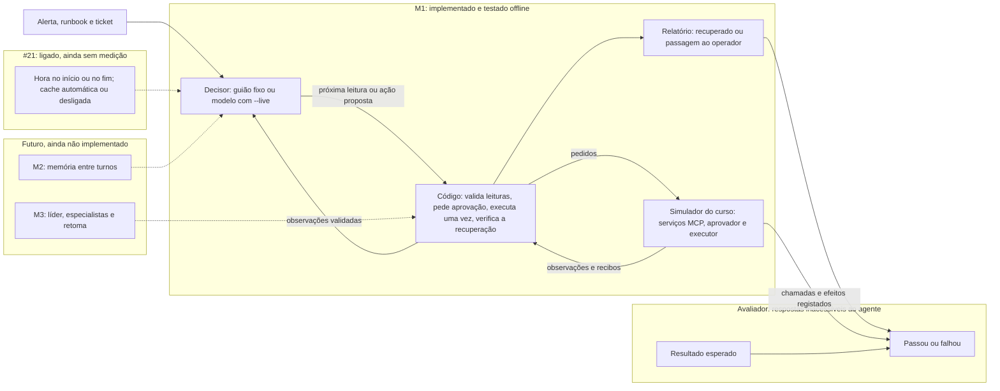
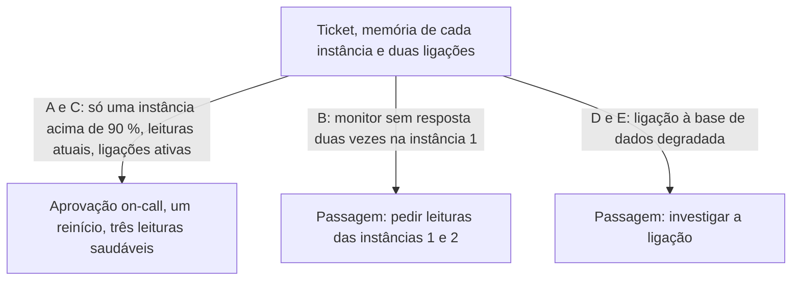

# Meridian: o agente de primeira linha

Projeto Agentic AI · M1 testado offline (`gateway-m1.6`) · dois pilotos reais no caso B, um por revisão (`gateway-m1.5` falhou, `gateway-m1.6` passou), sem linha de base

## Pergunta

O alerta diz «o gateway de ordens está lento». Em modo real, o agente reenvia ao modelo as mesmas instruções a cada passo. **Quando é que reutilizar contexto reduz o custo de investigar um incidente, e que evidência tem o agente de recolher de novo antes de agir?** Um reinício errado mais barato conta como falha.

- **Cache do fornecedor ([#21](https://github.com/jpboliv/meridian-project/issues/21)).** Primeiro, a hora simulada no início ou no fim da mensagem do utilizador; um texto comum pode não acabar num ponto elegível da cache, e só o fornecedor reporta leituras. Depois, hora no fim com cache automática contra desligada. Escrever na cache custa mais do que a entrada normal; só compensa se o incidente ficar mais barato com o mesmo resultado.
- **Lembrete com fonte.** Runbook completo contra runbook com lembrete, em C (novo alvo: instância 1) e D (nova causa: ligação à base de dados); o lembrete não dispensa leituras atuais.
- **Correção (teste proposto).** A latência começou a descer às 10:02 e o reinício foi às 10:05. Isto exclui que o reinício tenha iniciado a recuperação, não que tenha ajudado depois.

## Arquitetura



O modelo só propõe; a aprovação, o reinício único e a verificação ficam no código.



## Evidência

Os cinco casos passaram com decisões programadas em `gateway-m1.6`, com os mesmos resultados de `gateway-m1.5` ([registos](../first_line/offline-traces-m1.6.jsonl)). O laboratório offline usa só estas decisões programadas. Com o modelo real houve dois pilotos no caso B, um em cada revisão (ver abaixo).

**Reinício, caso A.** A instância 2 estava a 93,9 % de memória e as ligações ativas. Após o reinício aprovado (tick 23): 6,5, 5,0 e 5,0 ms. [Registo A](../first_line/offline-traces-m1.6.jsonl#L1).

**Falha controlada, caso B (programado).** O monitor falhou duas vezes na instância 1; a 2 nunca foi lida. Sem reinício, o agente pediu leituras das duas. [Registo B](../first_line/offline-traces-m1.6.jsonl#L2).

**Pilotos reais, caso B (21 nov. 2026), distintos do B programado.** Uma execução por revisão, com `gpt-6-luna` e os mesmos limites: até 3 pedidos e 512 tokens de saída por pedido.

- **Antes (`gateway-m1.5`, 3 pedidos).** O modelo escolheu os tickets três vezes, com o MRX-4100 já encontrado. Nunca escolheu o monitor nem a ligação. Falhou, sem efeitos. [Registo](../first_line/live-pilot-b-2026-11-21.jsonl#L1).
- **Alteração.** A `gateway-m1.6` mostra ao modelo o estado do ticket e os passos já concluídos ([registo offline](experiments.md#2026-11-21-the-completed-ticket-read-offline-gateway-m16)).
- **Depois (`gateway-m1.6`, 2 pedidos).** O modelo escolheu ler os tickets e depois as instâncias. Após o tempo limite do monitor, o código repetiu uma vez, verificou as duas ligações e produziu a passagem ao operador, a pedir leituras das duas instâncias. Passou nas 11 verificações, sem efeitos. [Registo](../first_line/live-pilot-b-m1.6-2026-11-21.jsonl#L1).

Custo a preços padrão: 0,0001781 USD antes e 0,0001389 USD depois (estimativa, não fatura). Há uma só observação por revisão, por isso não prova que a alteração causou a diferença. Também não é linha de base nem resultado do #21.

**Prefixo, offline.** Em 13 pares de decisões seguidas, o JSON do utilizador partilha 22 bytes iniciais (mediana) com a hora no início e 920 com ela no fim. São bytes, não tokens: não mostram leituras da cache nem se o prefixo chega aos 1024 tokens exigidos ([notas](experiments.md#context-reuse-arms-prepared-offline)).

## Experimentar

Na raiz do repositório:

```sh
uv run --locked streamlit run projects/course-02-agentic-ai/first_line/lab.py
```

Escolha um caso de A a E e carregue em **Executar caso**.

## Utilização de IA

Escrito com assistentes de IA, incluindo o Claude Code; os resultados programados acima não usam nenhum modelo; só os dois pilotos reais do caso B usaram o `gpt-6-luna`.
