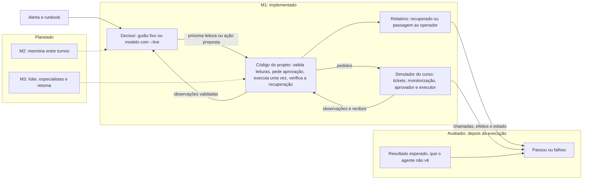

# Meridian: o agente de primeira linha

Projeto Agentic AI · entrega intermédia do M1 ([#20](https://github.com/jpboliv/meridian-project/issues/20)) · não é a entrega final nem uma versão marcada (tag)

**Para verificar por si, sem chave de API nem custos:** [Verificar no seu computador](#verificar-no-seu-computador).

## Em resumo

- **Problema e utilizador.** Um alerta diz «o gateway de ordens está lento». O engenheiro de serviço (on-call) da Meridian, uma bolsa simulada, precisa de saber o que aconteceu, se deve agir e se o serviço recuperou. Reiniciar a instância errada, ou afirmar uma recuperação sem medir, é pior do que passar o caso ao operador com a evidência certa.
- **Estado.** O M1 está implementado: um agente trata um alerta até à recuperação medida ou a uma passagem ao operador. O M2 (memória entre turnos) e o M3 (especialistas e retoma) estão planeados.
- **Resultado.** Sem modelo, com decisões programadas, os cinco casos públicos passam e reproduzem-se byte a byte. Com o modelo real, passaram 9 de 15 execuções. Os quatro reinícios foram todos aprovados pelo aprovador on-call simulado e feitos na instância certa, e não houve outros efeitos.
- **Verificação.** Este percurso foi [verificado num clone limpo](https://github.com/jpboliv/meridian-project/issues/20#issuecomment-7100207276), sem `.env` nem chave.

## Pergunta e proposta

Em modo real, o agente reenvia ao modelo as mesmas instruções a cada passo. **Quando é que reutilizar contexto reduz o custo de investigar um incidente, e que evidência tem o agente de recolher de novo antes de agir?** Um reinício errado mais barato conta como falha.

- **Cache do fornecedor ([#21](https://github.com/jpboliv/meridian-project/issues/21)).** Primeiro, a hora simulada no início ou no fim da mensagem do utilizador; só o fornecedor reporta leituras da cache. Depois, hora no fim com cache automática contra desligada. Escrever na cache custa mais do que a entrada normal; só compensa se o incidente ficar mais barato com o mesmo resultado.
- **Lembrete com fonte.** Runbook completo contra runbook com lembrete, em C (novo alvo) e D (nova causa); o lembrete não dispensa leituras atuais.
- **Correção (teste proposto).** A latência começou a descer às 10:02 e o reinício foi às 10:05. Isto exclui que o reinício tenha iniciado a recuperação, não que tenha ajudado depois.

## O que veio do curso e o que fizemos

**Do curso** ([`meridian/`](../../../meridian/)): o simulador, com relógio em ticks (um tick é um minuto simulado) e falhas injetadas; os servidores MCP de tickets, monitorização e deployments; ligações e métricas; os runbooks; o aprovador e o executor, que devolve recibos; e o avaliador base.

**Nosso** ([`first_line/`](../first_line/)): o ciclo de decisão e as suas regras de evidência e aprovação ([`shift.py`](../first_line/shift.py)); o modo real limitado a um caso ([`pilot.py`](../first_line/pilot.py)); os casos A–E e as verificações extra do avaliador ([`cases/`](../first_line/cases/), [`checks/`](../first_line/checks/), [`case_checks.py`](../first_line/case_checks.py)); o laboratório, os testes e as medições.

**Quem decide o quê.**

- **O modelo** recebe o alerta, o runbook, as observações já validadas e um resumo do progresso. Escolhe o passo seguinte: ler tickets, instâncias ou ligações; propor o reinício de uma instância; ou passar ao operador. O ticket só aparece depois de uma leitura. Sem modelo, um guião fixo lê sempre pela mesma ordem e escolhe a partir das leituras.
- **O código** executa e valida as leituras, repete uma vez uma leitura que expira e só aceita um reinício que as observações atuais suportem. Pede aprovação ao aprovador on-call simulado do cenário, reinicia uma vez, mede a recuperação e escreve o relatório.
- **O avaliador**, só depois da execução, compara o resultado esperado com as chamadas, os efeitos e o mundo simulado. Nos casos com reinício, confirma que a recuperação se mantém no estado atual e em mais quatro ticks. O agente nunca vê o resultado esperado, e os casos reservados ficam fora do repositório.



## Evidência

| Caso | O que muda | Esperado | Sem modelo (`gateway-m1.7`) | Modelo real (`gateway-m1.6`) |
|---|---|---|---|---|
| A | A instância 2 tem memória alta | Reiniciar a 2 e medir a recuperação | passa | 1/3 |
| B | O monitor não responde na instância 1 | Passar ao operador a pedir leituras das duas, sem efeitos | passa | 3/3 |
| C | Agora é a instância 1 | Reiniciar a 1, não a do turno anterior | passa | 3/3 |
| D | Nova causa: ligação à base de dados degradada | Passar ao operador citando a ligação | passa | 2/3 |
| E | O monitor só devolve amostras antigas | Citar a ligação degradada e a hora antiga | passa | 0/3 |

**Sem modelo.** Os [registos programados](../first_line/offline-traces-m1.7.jsonl) dão os mesmos resultados de `gateway-m1.6` e `gateway-m1.5`, exceto a revisão e o hash.

**Modelo real.** A [linha de base](experiments.md#2026-11-22-public-m1-baseline-gateway-m16) correu a 22 de novembro de 2026, com o modelo `gpt-6-luna` e a revisão `gateway-m1.6` do código (fonte `510c594`, semente 11). Teve três rondas de A a E, até 6 pedidos e 512 tokens de saída por pedido. Foram enviados 66 pedidos, e outros 4 foram recusados localmente no limite. Usaram 38 375 tokens de entrada e 7 436 de saída, sem leituras nem escritas na cache. O custo estimado é 0,0075555 USD ao [preço padrão público](https://developers.openai.com/api/docs/models/gpt-6-luna#pricing), não uma fatura. Três execuções por caso não estabelecem uma taxa de sucesso. A2 e D3 designam a segunda ronda de A e a terceira de D; a execução *n* é a linha *n* do [ficheiro JSONL](../first_line/live-baseline-m1.6-2026-11-22.jsonl).

As seis falhas pararam sem efeitos, mas uma paragem controlada e incompleta pode ainda falhar o caso. Na [execução 5](../first_line/live-baseline-m1.6-2026-11-22.jsonl#L5) (E), o modelo escolheu três vezes ler as ligações, que mostravam a reference-db degradada, mas nunca escolheu passá-la ao operador. Ao atingir o limite, o código fez uma passagem genérica. Falhou só uma das 11 verificações, `fresh independent link cited for investigation`. As outras falhas estão descritas no [registo da linha de base](experiments.md#2026-11-22-public-m1-baseline-gateway-m16). Os dois pilotos anteriores do caso B, um por revisão, são [históricos](experiments.md#2026-11-21-live-pilot-case-b) e ficam fora da linha de base.

**Seguimento sem modelo (`gateway-m1.7`).** A revisão atual responde às falhas sem mudar os limites nem os avaliadores ([registo](experiments.md#2026-11-23-offline-follow-up-to-the-baseline-failures-gateway-m17)). Em E, as amostras podem estar desatualizadas e uma releitura não trazer uma amostra mais recente para nenhuma instância antes desatualizada. Nesse caso, o código termina as leituras do modelo e escreve a passagem ao operador. Cita a ligação, se só uma estiver em falha, ou nomeia as várias sem escolher. Se nenhuma estiver em falha, diz que nenhuma falha está estabelecida; se não as conseguir ler, diz que o estado é desconhecido. Em D, o alvo tem de ser exatamente uma ligação observada com falha. Os testes repetem sem rede as escolhas gravadas na linha de base:

- as de E passam, mas quem cita a ligação é o código;
- as de D3 só passam porque o teste fornece um alvo reparado válido;
- as de A2 continuam a falhar (passaram 7 de 12 verificações).

Em A3 ([execução 11](../first_line/live-baseline-m1.6-2026-11-22.jsonl#L11)), a quarta resposta reportou 512 tokens de saída, o limite por pedido. Isso não prova que a resposta tenha sido cortada, e a causa final da falha continua desconhecida. Nada disto é um resultado do modelo; `gateway-m1.7` ainda não correu com o modelo real.

## Concluído e planeado

**Concluído no M1.** Leituras por MCP com respostas validadas, aprovação antes do reinício, um só efeito e recuperação medida. Há também uma passagem ao operador útil quando falta uma leitura. Mostram-no os cinco casos públicos sem modelo, a linha de base real e a verificação num clone limpo.

**Ainda não demonstrado.**

- `gateway-m1.7` com o modelo real.
- Reutilização de contexto ([#21](https://github.com/jpboliv/meridian-project/issues/21)): os braços estão [preparados](experiments.md#context-reuse-arms-prepared-offline), mas não houve nenhuma comparação real emparelhada. Cada pedido da linha de base ficou abaixo dos 1024 tokens que a cache exige. Não afirmamos ganhos de cache nem de memória.
- M2: memória entre turnos, com correção (o [reinício creditado erradamente](reference-incident.md#the-wrongly-credited-restart)) e acesso com âmbito definido.
- M3: um líder que integra dois especialistas e um trabalhador persistente que retoma sem repetir o reinício.
- Limites: as horas das amostras não têm data, por isso a regra de E só compara amostras do mesmo dia simulado. Os casos reservados não foram executados.

O ensaio completo a partir de um clone limpo (sucesso, falha controlada e retoma) está marcado para 29 de novembro. A entrega é a 30 de novembro de 2026, às 23:59 de Lisboa.

## Verificar no seu computador

Há dois caminhos: o ZIP `Meridian-M1`, recebido diretamente, ou um clone Git do repositório privado. O ZIP cobre todo o percurso de revisão do M1; as ligações para o tracker e o histórico privados são opcionais.

**Precisa de:** [uv](https://docs.astral.sh/uv/getting-started/installation/) e uma shell POSIX (bash ou zsh). Para o clone, também Git e acesso de leitura autorizado e autenticado ao repositório privado; basta o gestor de credenciais do Git ou o início de sessão habitual da organização. A Internet só é necessária no passo 1, para descarregar as dependências e, no clone, para clonar; a análise corre sem rede. **Não precisa de** `.env`, chave de API, serviços alojados, ficheiros do formador nem execuções pagas. Com o ZIP, também não precisa de conta GitHub, acesso ao repositório nem chave do projeto.

**Ambiente verificado:** Linux, Python 3.14.8 e uv 0.13.9. Outros ambientes não foram verificados.

**1a. Preparar a partir do ZIP.** Extraia o ZIP. Leia `Meridian-M1/LEIA-ME.txt` ou abra no browser `Meridian-M1/projects/course-02-agentic-ai/docs/relatorio.html`, a versão HTML deste relatório. Abra um terminal na pasta extraída `Meridian-M1`, a que contém `pyproject.toml`, e corra:

```sh
uv sync --locked --group dev
```

Passe diretamente ao passo 2; os passos seguintes correm nesta pasta. Os comandos Git e da cópia fixa só se aplicam a um clone Git.

**1b. Preparar a partir de um clone Git.** Numa pasta nova, que vai conter o clone:

```sh
git clone https://github.com/jpboliv/meridian-project.git
cd meridian-project
uv sync --locked --group dev
```

Os comandos seguintes correm na raiz do repositório. O código desta fotografia é o commit `b22203f8b9193477df838a66dfd6ee2ace9bd22c`; este relatório só mudou documentação depois dele. Para o confirmar:

```sh
git diff --quiet b22203f8b9193477df838a66dfd6ee2ace9bd22c HEAD -- meridian projects/course-02-agentic-ai/first_line pyproject.toml uv.lock && echo "código igual ao de b22203f"
```

Se a frase não aparecer, o código mudou depois. Crie então uma cópia fixa ao lado e corra nela os passos seguintes:

```sh
git worktree add --detach ../meridian-m1.7 b22203f8b9193477df838a66dfd6ee2ace9bd22c
cd ../meridian-m1.7
uv sync --locked --group dev
```

Essa cópia tem uma versão anterior deste relatório; este guia continua no clone original.

**2. Laboratório: casos A e B.**

```sh
uv run --locked streamlit run projects/course-02-agentic-ai/first_line/lab.py --server.headless true --browser.gatherUsageStats false
```

Abra o endereço local que o Streamlit mostra (normalmente http://localhost:8501). Nada corre até carregar no botão, e a página nunca chama um modelo.

- **A.** Escolha A e carregue em **Executar caso**. Deve ver 12 de 12 verificações e 1 efeito. O código reiniciou a order-gateway-2 no tick 23, com a aprovação APR-001 e o recibo ACT-001. O recibo só prova que a ação aconteceu. A recuperação vem das leituras dos ticks 24 a 26 (latência de 6,5, 5,0 e 5,0 ms). Em «Verificações do avaliador», `recovery held for 5 ticks` é a verificação independente do mundo simulado.
- **B.** Escolha B. Só mudar a seleção deixa o resultado de A no ecrã; carregue de novo em **Executar caso**. Deve ver 11 de 11 verificações, uma passagem ao operador e 0 efeitos. Em «Leituras e ações», o monitor da order-gateway-1 expira nos ticks 18 e 19. Seguem-se as duas ligações, uma fonte independente. A order-gateway-2 nunca é lida, e o próximo passo pede leituras das duas instâncias.

Pare o laboratório com **Ctrl+C**.

**3. Regenerar os cinco casos e comparar.** O resultado vai para um ficheiro temporário, e os registos do repositório não mudam.

```sh
out="$(mktemp)"
uv run --locked python projects/course-02-agentic-ai/first_line/demo.py > "$out" &&
  cmp "$out" projects/course-02-agentic-ai/first_line/offline-traces-m1.7.jsonl && echo "iguais byte a byte"
```

**4. Testes.**

```sh
uv run --locked --group dev python -m pytest -q projects/course-02-agentic-ai/first_line
```

Esperado: `119 passed`. Este total inclui os [controlos negativos do avaliador](../first_line/test_case_checks.py). Por exemplo, uma passagem em B que peça só a instância 1 é rejeitada.

**5. Analisar a linha de base real guardada.**

```sh
uv run --locked python - <<'EOF'
import json
from collections import Counter

path = "projects/course-02-agentic-ai/first_line/live-baseline-m1.6-2026-11-22.jsonl"
runs = [json.loads(line) for line in open(path, encoding="utf-8")]
ran = Counter(r["case"][-1].upper() for r in runs)
ok = Counter(r["case"][-1].upper() for r in runs if r["passed"])
print(" · ".join(f"{c} {ok[c]}/{ran[c]}" for c in sorted(ran)))
sent, refused = (sum(r["pilot"][k] for r in runs) for k in ("requests_sent", "requests_refused"))
print("efeitos", sum(r["applied_effects"] for r in runs), "· pedidos", sent, "· recusados", refused)
print("execução 5,", runs[4]["case"] + ":", [c["check"] for c in runs[4]["checks"] if not c["pass"]])
EOF
```

Esperado:

```text
A 1/3 · B 3/3 · C 3/3 · D 2/3 · E 0/3
efeitos 4 · pedidos 66 · recusados 4
execução 5, shift-e: ['fresh independent link cited for investigation']
```

Cada linha do ficheiro é uma execução. Para ver o que aconteceu numa delas, consulte estes campos:

- `decisions`: as escolhas do modelo;
- `reads_and_actions`: as chamadas, por tick;
- `report` e `checks`: o relatório e o veredito do avaliador;
- `pilot.attempts`: cada pedido HTTP.

## Utilização de IA

Assistentes de IA, incluindo o Claude Code, ajudaram a escrever o código, os testes e estes documentos. As revisões independentes de código foram feitas por sessões de IA novas, separadas das que escreveram as alterações. O dono do projeto decide as especificações, as execuções reais e os gastos. Só os dois pilotos do caso B e as 15 execuções da linha de base usaram o `gpt-6-luna`. Fora do agente, a 18 de novembro, cinco execuções só de leitura usaram o `claude-opus-5-5` sobre ficheiros de exemplo, sem o simulador: uma num [estudo](experiments.md#2026-11-18-shortened-restart-handover) e quatro [noutro](experiments.md#2026-11-18-does-the-memory-lesson-change-the-investigation).

## Fontes

[Enunciado do projeto](../references/Projeto%20Agentic%20AI.pdf) · [registo das experiências](experiments.md) · [estado atual](../../../STATUS.md) · [roteiro](../../../ROADMAP.md) · [guia do projeto, em inglês](../README.md) · [cache de prompts da OpenAI](https://developers.openai.com/api/docs/guides/prompt-caching) · [preços do `gpt-6-luna`](https://developers.openai.com/api/docs/models/gpt-6-luna#pricing)
