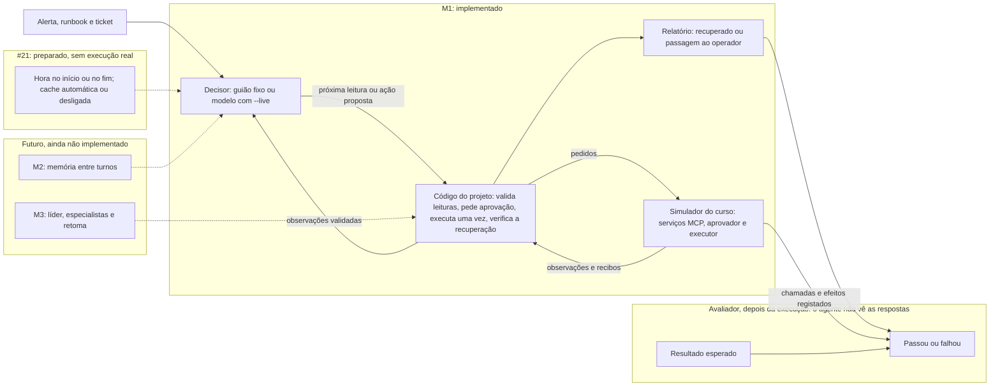
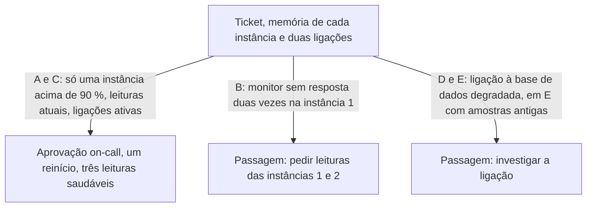

# Meridian: o agente de primeira linha

Projeto Agentic AI · entrega intermédia do M1 ([#20](https://github.com/jpboliv/meridian-project/issues/20)) · não é a entrega final nem uma versão marcada (tag)

**Para verificar por si, sem chave de API nem custos:** [Verificar no seu computador](#verificar-no-seu-computador).

## Em resumo

- **Problema.** Um alerta diz «o gateway de ordens está lento». É preciso saber o que aconteceu, se se deve agir e se o serviço recuperou. Reiniciar a instância errada, ou afirmar uma recuperação sem medir, é pior do que passar o caso a uma pessoa com a evidência certa.
- **Utilizador.** O engenheiro de serviço (on-call) da Meridian, uma bolsa simulada. O agente investiga e propõe; uma pessoa aprova qualquer reinício.
- **Estado.** O M1 está implementado: um agente trata um alerta, do pedido até à recuperação verificada ou a uma passagem ao operador útil. O M2 (memória entre turnos) e o M3 (equipa de especialistas e retoma) estão planeados, não implementados.
- **Resultado.** Com decisões programadas, sem modelo, os cinco casos públicos passam na revisão atual (`gateway-m1.7`) e reproduzem-se byte a byte. Com o modelo real (`gpt-6-luna`, revisão `gateway-m1.6`), passaram 9 de 15 execuções. Houve quatro reinícios simulados, todos autorizados e na instância certa, e nenhum outro efeito. As seis falhas pararam sem efeitos; parar em segurança, porém, não é o mesmo que passar no avaliador.

## Pergunta e proposta

Em modo real, o agente reenvia ao modelo as mesmas instruções a cada passo. **Quando é que reutilizar contexto reduz o custo de investigar um incidente, e que evidência tem o agente de recolher de novo antes de agir?** Um reinício errado mais barato conta como falha.

- **Cache do fornecedor ([#21](https://github.com/jpboliv/meridian-project/issues/21)).** Primeiro, a hora simulada no início ou no fim da mensagem do utilizador; um texto comum pode não acabar num ponto elegível da cache, e só o fornecedor reporta leituras. Depois, hora no fim com cache automática contra desligada. Escrever na cache custa mais do que a entrada normal; só compensa se o incidente ficar mais barato com o mesmo resultado.
- **Lembrete com fonte.** Runbook completo contra runbook com lembrete, em C (novo alvo: instância 1) e D (nova causa: ligação à base de dados); o lembrete não dispensa leituras atuais.
- **Correção (teste proposto).** A latência começou a descer às 10:02 e o reinício foi às 10:05. Isto exclui que o reinício tenha iniciado a recuperação, não que tenha ajudado depois.

## O que veio do curso e o que fizemos

**Fornecido pelo curso** ([`meridian/`](../../../meridian/)): o simulador da bolsa, com relógio em ticks (um tick é um minuto simulado) e falhas injetadas; os servidores MCP de tickets, monitorização e deployments; a verificação de ligações e as métricas; os runbooks; o aprovador e o executor, que devolve recibos; e o avaliador base (leituras exigidas, efeitos, aprovações e recuperação mantida durante N ticks).

**Feito neste projeto** ([`first_line/`](../first_line/)):

- o ciclo de decisão de primeira linha ([`shift.py`](../first_line/shift.py)): que leituras correr, validação de cada resposta, portas de evidência e de aprovação, um só reinício, leituras de recuperação e o relatório;
- o modo real limitado a um caso ([`pilot.py`](../first_line/pilot.py)): limites de pedidos e de tokens, registo do uso reportado e códigos de falha;
- os casos públicos A–E ([`cases/`](../first_line/cases/)), incluindo um monitor que só devolve amostras antigas (E, [`workbench.py`](../first_line/workbench.py)), e verificações extra do avaliador ([`case_checks.py`](../first_line/case_checks.py), [`checks/`](../first_line/checks/));
- o laboratório ([`lab.py`](../first_line/lab.py)), a linha de comandos ([`demo.py`](../first_line/demo.py)), os testes e as medições.

**Quem decide o quê.**

- **O modelo escolhe** o passo seguinte: ler tickets, instâncias ou ligações; propor o reinício de uma instância; ou passar ao operador, com uma ligação em falha como alvo ou sem alvo. Recebe o incidente, o runbook, as observações já validadas e um campo `progress` calculado pelo código. Sem modelo, um guião fixo faz estas escolhas: lê sempre pela mesma ordem e escolhe o alvo a partir das leituras, sem ver o nome do caso nem a resposta esperada.
- **O código faz** o resto. Executa as leituras de cada passo (`links` lê sempre as duas ligações) e valida as respostas. Repete uma vez uma leitura que expira. Só aceita um reinício quando as observações atuais o suportam, pede aprovação on-call e executa uma vez. Lê três amostras depois do recibo e escreve o relatório. Limita cada caso a 8 decisões e, em modo real, aos pedidos e tokens autorizados.
- **O avaliador vê, depois da execução,** o resultado esperado ([`checks/`](../first_line/checks/)), as chamadas registadas, os efeitos do executor e o mundo simulado, que avança mais 5 ticks para confirmar que a recuperação se mantém. O agente nunca recebe estes ficheiros: [`run_case`](../first_line/demo.py) só os carrega depois de o turno terminar. Os casos reservados para avaliação ficam fora do repositório.

## Arquitetura



O modelo só propõe; a aprovação, o reinício único e a verificação ficam no código.



## Evidência

Há quatro tipos de evidência, que não se devem misturar:

| Evidência | Revisão | Quem decide | Resultado |
|---|---|---|---|
| [Registos programados](../first_line/offline-traces-m1.7.jsonl), 5 casos públicos | `gateway-m1.7` | guião fixo, sem modelo | 5/5 passam; reproduzem-se byte a byte; iguais aos de `m1.6` e `m1.5`, exceto a revisão e o hash |
| [Linha de base real](experiments.md#2026-11-22-public-m1-baseline-gateway-m16), 22 nov. 2026, 15 execuções | `gateway-m1.6` | `gpt-6-luna` | 9/15 passam: A 1/3, B 3/3, C 3/3, D 2/3, E 0/3 |
| Pilotos reais do caso B, 21 nov. 2026 | `m1.5` e `m1.6` | `gpt-6-luna`, uma execução por revisão | histórico, fora da linha de base |
| [Seguimento offline](experiments.md#2026-11-23-offline-follow-up-to-the-baseline-failures-gateway-m17), 23 nov. 2026 | `gateway-m1.7` | escolhas gravadas, repetidas sem rede | E e D3 passam, A2 continua a falhar; **sem resultado real** |

**Caso A: o recibo não prova a recuperação.** O ticket MRX-4100 corresponde ao incidente. A instância 2 estava a 93,9 % de memória, a 1 a 55 %, e as duas ligações estavam ativas. O código pediu aprovação (APR-001) e reiniciou a instância 2 uma vez, no tick 23 (recibo ACT-001). O recibo só prova que a ação aconteceu. A recuperação vem de leituras novas: 6,5, 5,0 e 5,0 ms nos ticks 24, 25 e 26, com 0,1 % de erros. Depois, o avaliador avança o simulador e confirma, por conta própria, que a latência e os erros ficam abaixo dos limites durante 5 ticks. [Registo A](../first_line/offline-traces-m1.7.jsonl#L1).

**Caso B: falha controlada.** O monitor de instâncias expirou duas vezes na instância 1: a leitura no tick 18 e a única repetição no tick 19. O código consultou então uma fonte independente, as duas ligações (ticks 20 e 21, ambas ativas). A instância 2 nunca foi lida, por isso não há base para comparar instâncias nem para reiniciar. O relatório diz que leitura falhou, que a instância 2 ficou por ler, e pede leituras das duas. Zero efeitos e nenhuma afirmação de recuperação. [Registo B](../first_line/offline-traces-m1.7.jsonl#L2).

**Pilotos reais do caso B.** Uma execução por revisão, com até 3 pedidos. Em `gateway-m1.5`, o modelo repetiu a pesquisa de tickets três vezes e falhou. A `gateway-m1.6` passou a mostrar-lhe os passos já concluídos; nessa revisão, o modelo escolheu ler tickets e depois instâncias, e o caso passou nas 11 verificações. Uma observação por revisão não prova a causa da diferença. [Primeiro](experiments.md#2026-11-21-live-pilot-case-b) e [segundo piloto](experiments.md#2026-11-21-live-pilot-case-b-gateway-m16).

**Linha de base real (22 nov. 2026, `gateway-m1.6`).** Três rondas de A a E, cada execução num processo e num simulador novos, com `gpt-6-luna`, até 6 pedidos e 512 tokens de saída por pedido. Passaram 9 de 15. Houve quatro reinícios autorizados, todos na instância certa, e nenhum outro efeito. Foram enviados 66 pedidos; outros 4 foram recusados localmente, ao atingir o limite. Os pedidos usaram 38 375 tokens de entrada e 7 436 de saída, com zero leituras e zero escritas na cache. O custo estimado é 0,0075555 USD, ao [preço padrão público](https://developers.openai.com/api/docs/models/gpt-6-luna#pricing); é uma estimativa, não uma fatura. Três execuções por caso não estabelecem uma taxa de sucesso.

- **E, 0/3.** Na [execução 5](../first_line/live-baseline-m1.6-2026-11-22.jsonl#L5), o modelo escolheu tickets, duas vezes instâncias e três vezes ligações. O código registou a ligação a reference-db degradada nos ticks 73, 75 e 77, mas o modelo nunca escolheu a passagem com essa ligação. O sétimo pedido foi recusado localmente e o código fez uma passagem genérica, sem efeitos. Falhou só uma das 11 verificações, `fresh independent link cited for investigation`: o relatório não tem o `follow_up` que cita a ligação degradada e o tick em que foi observada. Nas execuções 10 e 15, o modelo nem chegou a ler as ligações.
- **D, 2/3.** Na [execução 14](../first_line/live-baseline-m1.6-2026-11-22.jsonl#L14), o alvo foi `reference-db (observed degraded at tick 22)` em vez do identificador exato. O código deu a passagem genérica e falhou a mesma verificação.
- **A, 1/3.** Na [execução 6](../first_line/live-baseline-m1.6-2026-11-22.jsonl#L6), o modelo releu, nunca pediu o reinício e esgotou os pedidos. Na [execução 11](../first_line/live-baseline-m1.6-2026-11-22.jsonl#L11), a quarta resposta chegou ao limite de 512 tokens; o registo não guardou a causa da falha.

**Seguimento offline (23 nov. 2026, `gateway-m1.7`).** Os limites, os avaliadores e os registos anteriores não mudaram.

- **E.** Enquanto as amostras estão desatualizadas, uma releitura que não traz nenhuma amostra mais recente termina as leituras do modelo. O código lê então as ligações, se o modelo não acabou de as ler, e passa ao operador a ligação degradada com a fonte. Se não houver uma falha única, diz que nenhuma está estabelecida; se essa leitura falhar, diz que o estado das ligações é desconhecido. O relatório marca esta decisão como do código (`stale_evidence`).
- **D.** O alvo da passagem tem de ser exatamente uma ligação observada com falha; caso contrário, o modelo tem uma reparação e depois há uma passagem segura.
- **A.** O modelo vê quando as observações atuais já suportam o reinício, pela mesma regra que o autoriza. Uma decisão falhada recebe um código: limite de saída, validação esgotada, erro do fornecedor ou desconhecido.

Os testes repetem as escolhas gravadas na linha de base, sem rede nem custos. As escolhas das execuções 5, 10 e 15 (E) terminam ao fim de 3 pedidos; o código lê as ligações nos ticks 73–74 e cita reference-db no tick 73, e o caso passa nas 11 verificações. O alvo decorado da execução 14 (D) é rejeitado; a resposta válida que se segue foi escrita pelo teste, não pelo modelo, e o caso passa. As escolhas da execução 6 (A) continuam a falhar (7 de 12 verificações). Nada disto é um resultado do modelo. Em E, quem cita a ligação é o código, não o modelo.

## O que ainda não está demonstrado

- **`gateway-m1.7` com o modelo real.** Ainda não correu; uma execução real precisa de decisões separadas do dono do projeto sobre definições e gastos.
- **Reutilização de contexto ([#21](https://github.com/jpboliv/meridian-project/issues/21)).** Os três braços estão [preparados offline](experiments.md#context-reuse-arms-prepared-offline), mas não houve nenhuma comparação real emparelhada. Na linha de base, cada pedido ficou abaixo dos 1024 tokens que a cache exige e não houve leituras da cache. Offline, só medimos bytes: o JSON do utilizador partilha 22 bytes iniciais (mediana) com a hora no início e 920 com ela no fim. Não são tokens nem leituras da cache. Não afirmamos ganhos de cache nem de memória.
- **M2.** Memória entre turnos com correção (o caso planeado do [reinício creditado erradamente](reference-incident.md#the-wrongly-credited-restart)) e acesso com âmbito definido.
- **M3.** Um líder que integra dois especialistas e um trabalhador persistente que retoma após uma interrupção sem repetir o reinício.
- **Limites.** As horas das amostras não têm data (`HH:MM`), por isso a regra de E só compara amostras do mesmo dia simulado. A causa da falha da execução 11 continua desconhecida. Os casos reservados não foram executados.

Esta é uma fotografia do M1, não a entrega final nem uma versão marcada. O ensaio a partir de um clone limpo está marcado para 29 de novembro; a entrega é a 30 de novembro de 2026, às 23:59 de Lisboa.

## Verificar no seu computador

**Precisa de:** acesso de leitura autorizado ao repositório privado, Git, [uv](https://docs.astral.sh/uv/getting-started/installation/) e uma shell POSIX (bash ou zsh) para o último bloco. A rede só é usada no passo 1, para descarregar as dependências. **Não precisa de** `.env`, chave de API, serviços alojados, ficheiros do formador nem execuções pagas. Corra tudo na raiz do repositório.

**1. Preparar.**

```sh
git clone https://github.com/jpboliv/meridian-project.git
cd meridian-project
uv sync --locked --group dev
```

O código executável desta fotografia é o commit `b22203f8b9193477df838a66dfd6ee2ace9bd22c` (`gateway-m1.7`). Este relatório é um commit posterior que só altera documentação. Para confirmar que o código é o mesmo:

```sh
git diff --quiet b22203f8b9193477df838a66dfd6ee2ace9bd22c HEAD -- meridian projects/course-02-agentic-ai/first_line pyproject.toml uv.lock && echo "código igual ao de b22203f"
```

Se a frase não aparecer, o código mudou depois desta fotografia. Nesse caso, crie uma cópia fixa ao lado, com `git worktree add --detach ../meridian-m1.7 b22203f8b9193477df838a66dfd6ee2ace9bd22c`, e corra lá `uv sync --locked --group dev` e os passos seguintes. Essa cópia tem a versão anterior deste relatório; este guia continua na pasta original.

**2. Laboratório: casos A e B.**

```sh
uv run --locked streamlit run projects/course-02-agentic-ai/first_line/lab.py --server.headless true --browser.gatherUsageStats false
```

Abra http://localhost:8501. A página não executa nada até carregar no botão e nunca chama um modelo.

- Escolha **A** e carregue em **Executar caso**. Deve ver «Caso A: passou (12 de 12 verificações do avaliador)», a decisão final «recuperado» e 1 efeito aplicado. Confirme «Reiniciou order-gateway-2 no tick 23 (aprovação APR-001, recibo ACT-001)» e, em «Leituras depois do reinício», os ticks 24, 25 e 26, com latências de 6,5, 5,0 e 5,0 ms. Em «Verificações do avaliador», `recovery held for 5 ticks` é a verificação independente do mundo simulado.
- Escolha **B** e carregue de novo em **Executar caso**. Deve ver «Caso B: passou (11 de 11 …)», «passagem ao operador» e 0 efeitos. Em «Leituras e ações», há duas chamadas ao monitor da order-gateway-1 (ticks 18 e 19), ambas com `timed out`, nenhuma à order-gateway-2, e depois as duas ligações. O próximo passo pede leituras das duas instâncias.

Pare o laboratório com **Ctrl+C**.

**3. Regenerar os cinco casos e comparar com os registos guardados.** O resultado vai para um ficheiro temporário; os registos do repositório não são alterados.

```sh
out="$(mktemp)"
uv run --locked python projects/course-02-agentic-ai/first_line/demo.py > "$out" &&
  cmp "$out" projects/course-02-agentic-ai/first_line/offline-traces-m1.7.jsonl && echo "iguais byte a byte"
```

Esperado: `iguais byte a byte`. Cada linha guarda `harness_sha256`, o hash de `shift.py`, por isso a igualdade também confirma o código do ciclo de decisão.

**4. Testes (opcional).**

```sh
uv run --locked python -m pytest -q projects/course-02-agentic-ai/first_line
uv run --locked python -m pytest -q projects/course-02-agentic-ai/first_line/test_case_checks.py
```

Esperado: `119 passed`, e depois `11 passed`. O segundo ficheiro é o controlo negativo: cada teste altera a evidência de um caso que passa e confirma que o avaliador o rejeita. Por exemplo, uma recuperação baseada numa leitura demasiado próxima do reinício, uma amostra inventada, ou uma passagem em B que pede só a instância 1. As repetições de E e D3 descritas acima estão em [`test_followup.py`](../first_line/test_followup.py).

**5. Analisar a linha de base real, a partir do ficheiro guardado.**

```sh
uv run --locked python - <<'EOF'
import json
from collections import Counter

path = "projects/course-02-agentic-ai/first_line/live-baseline-m1.6-2026-11-22.jsonl"
runs = [json.loads(line) for line in open(path, encoding="utf-8")]
ok = Counter(r["case"][-1].upper() for r in runs if r["passed"])
print("passaram", sum(ok.values()), "de", len(runs), "·", " ".join(f"{c}{ok[c]}" for c in "ABCDE"))
acoes = [(n, r["report"]["action"]["target"]) for n, r in enumerate(runs, 1) if r["report"]["action"]]
print("efeitos", sum(r["applied_effects"] for r in runs), "· reinícios", acoes)
p = [r["pilot"] for r in runs]
tin, tout = (sum(x[k] for x in p) for k in ("reported_input_tokens", "reported_output_tokens"))
print("pedidos", sum(x["requests_sent"] for x in p), "· recusados", sum(x["requests_refused"] for x in p),
      "· tokens", tin, tout, "· USD", round((tin * 0.10 + tout * 0.50) / 1e6, 7))
for n, r in enumerate(runs, 1):
    if not r["passed"]:
        print("execução", n, r["case"], [c["check"] for c in r["checks"] if not c["pass"]])
EOF
```

Esperado:

```text
passaram 9 de 15 · A1 B3 C3 D2 E0
efeitos 4 · reinícios [(1, 'order-gateway-2'), (3, 'order-gateway-1'), (8, 'order-gateway-1'), (13, 'order-gateway-1')]
pedidos 66 · recusados 4 · tokens 38375 7436 · USD 0.0075555
execução 5 shift-e ['fresh independent link cited for investigation']
execução 6 shift-a ['report claim', "read {'tool': 'read_metrics', 'component': 'order-gateway'}", 'restart_instance order-gateway-2 done', 'recovery held for 5 ticks', '3 consecutive healthy readings observed after the applied restart']
execução 10 shift-e ["read {'tool': 'check_link', 'source': 'order-gateway', 'target': 'reference-db'}", 'fresh independent link cited for investigation']
execução 11 shift-a ['report claim', "read {'tool': 'read_metrics', 'component': 'order-gateway'}", 'restart_instance order-gateway-2 done', 'recovery held for 5 ticks', '3 consecutive healthy readings observed after the applied restart']
execução 14 shift-d ['fresh independent link cited for investigation']
execução 15 shift-e ["read {'tool': 'check_link', 'source': 'order-gateway', 'target': 'reference-db'}", 'fresh independent link cited for investigation']
```

O caso A espera um reinício na order-gateway-2; o C, na order-gateway-1. O custo usa o preço padrão de 0,10 USD por milhão de tokens de entrada e 0,50 USD por milhão de saída. Cada linha do ficheiro é uma execução. Para ver o que aconteceu, abra os campos `decisions` (escolhas do modelo), `reads_and_actions` (chamadas, por tick), `report`, `checks` (veredito do avaliador) e `pilot.attempts` (cada pedido HTTP).

## Utilização de IA

O código, os testes e estes documentos foram escritos com assistentes de IA, incluindo o Claude Code. Pelas regras do projeto, cada pedido de integração é revisto por uma instância nova antes do merge. O dono do projeto decide as especificações, as execuções reais e os gastos. Os resultados programados não usam nenhum modelo; só os dois pilotos do caso B e as 15 execuções da linha de base usaram o `gpt-6-luna`. Dois ensaios de desenho de 18 de novembro, só de leitura e fora do agente, usaram o `claude-opus-5-5` ([registo](experiments.md#2026-11-18-shortened-restart-handover)).

## Fontes

[Enunciado do projeto](../references/Projeto%20Agentic%20AI.pdf) · [registo das experiências](experiments.md) · [estado atual](../../../STATUS.md) · [roteiro](../../../ROADMAP.md) · [guia do projeto, em inglês](../README.md) · [cache de prompts da OpenAI](https://developers.openai.com/api/docs/guides/prompt-caching) · [preços do `gpt-6-luna`](https://developers.openai.com/api/docs/models/gpt-6-luna#pricing)
