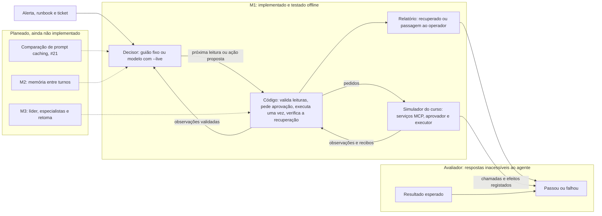
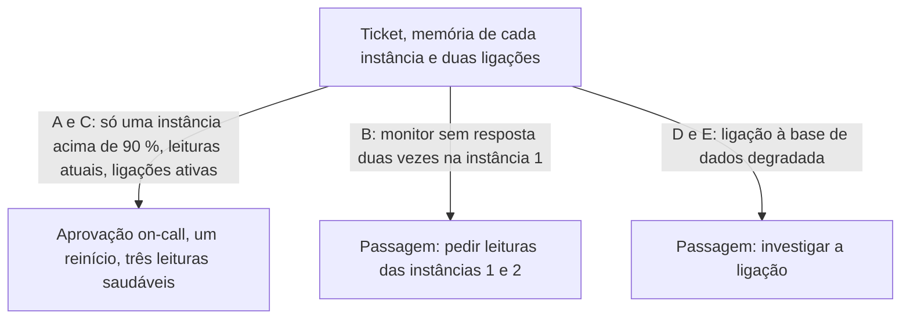

# Meridian: o agente de primeira linha

Projeto Agentic AI · M1 testado offline (`gateway-m1.5`) · sem resultados com modelo real

## Problema e pergunta

O alerta diz «o gateway de ordens está lento». O agente tem de encontrar a causa sem reiniciar a instância errada nem inventar uma recuperação. Em modo real (`--live`), cada passo volta a enviar ao modelo as mesmas instruções; os resultados abaixo usam decisões programadas. Pergunta de prompt caching: **pôr a hora no fim do pedido, e não no início, aumenta a reutilização reportada pelo fornecedor e baixa o custo do incidente inteiro, sem piorar a decisão?** Um reinício errado mais barato conta como falha.

## Arquitetura



O decisor só propõe; a aprovação, o reinício único e a verificação de três leituras saudáveis ficam no código.



## Resultados

Medido: os cinco casos públicos passam, uma vez cada, com decisões programadas ([cinco registos](../first_line/offline-traces-m1.5.jsonl)). Por medir: o comportamento de um modelo real e a comparação de caching ([#8](https://github.com/jpboliv/meridian-project/issues/8), [#21](https://github.com/jpboliv/meridian-project/issues/21)).

**Reinício, caso A.** A instância 2 estava a 93,9 % de memória, com as ligações ativas. A aprovação APR-001 autorizou o reinício ACT-001 no tick 23. As leituras dos ticks 24 a 26 deram 6,5, 5,0 e 5,0 ms. O avaliador contou um efeito. [Registo A](../first_line/offline-traces-m1.5.jsonl#L1).

**Falha controlada, caso B.** O monitor não respondeu duas vezes à instância 1, por isso a instância 2 nunca foi lida. As ligações estavam ativas, mas não indicam qual instância tem memória alta. Sem reinício nem efeitos, o agente pediu leituras das duas instâncias. [Registo B](../first_line/offline-traces-m1.5.jsonl#L2).

## Experimentar

Na raiz do repositório, sem chave de API:

```sh
uv run --locked streamlit run projects/course-02-agentic-ai/first_line/lab.py
```

Escolha um caso de A a E e carregue em **Executar caso**. Abrir a página não executa nada.

## Utilização de IA

Código, testes e documentos foram escritos com assistentes de IA, incluindo o Claude Code. O autor reviu as decisões marcadas como acordadas. Os resultados acima não usam nenhum modelo.

Detalhes: [projeto](project.md), [arquitetura](architecture.md), [especificações](specs/), [decisões](decisions.md) e [experiências](experiments.md#case-b-the-replica-that-was-never-read).
